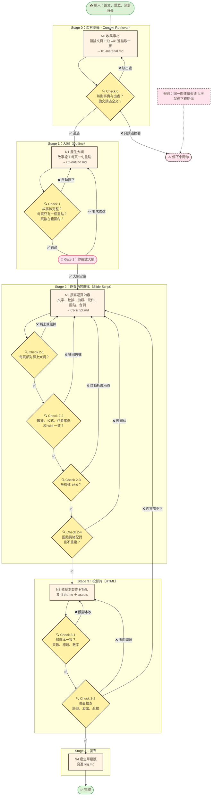

# 投影片製作 Graph（v1.0，已定案）

> 老師的要求：先整理大綱 → 大綱確認 → 再做投影片逐頁內容 → 最後依此做成投影片。要設計成 graph，想清楚各階段要做的、如何檢查。
> 瀏覽器版：`outputs/graph/slide-pipeline.html`，直接讀取本檔的流程圖，只要改這裡就好

## 已決定的事
- 中間產物存成獨立的 Markdown 檔：`outputs/slides/specs/{論文}/`
- 人工確認關卡**只有 Gate 1（大綱）**；大綱定案後，Stage 2、3 自動跑完，遇到問題才停下來問
- 重點自動檢查：防爆版自動拆頁、圖貼情緒配對且不重複、數據與公式完整

## 流程圖

## 各節點說明

| 節點 | 輸入 | 做什麼 | 產出 |
|---|---|---|---|
| N0 收集素材 | 論文頁 | 讀 `wiki/papers/` 論文頁，沿 `[[連結]]` 讀一層相關的概念頁、問題頁，整理成事實清單，每則附出處 | `01-material.md` |
| N1 產生大綱 | `01-material.md` | 排出故事線（開場 → 概念 → 方法 → 發現 → 反思 → 結論），每頁寫標題、一句重點、引用哪些素材 | `02-outline.md` |
| N2 撰寫逐頁內容 | 定案的 `02-outline.md` | 每頁寫內文、數據、抽屜內容、用哪個元件、圖貼和表情、對話泡泡台詞、出處 | `03-script.md` |
| N3 製作 HTML | `03-script.md` | 照腳本套用 `theme/` 和 `assets/`，不自行增減內容 | `{論文}.html` |
| N4 發布 | HTML | 執行 `bundle_slides.py` 產生單檔版，寫進 `log.md` | `dist/…standalone.html` |

## 各檢查說明

| 檢查 | 怎麼檢查 | 沒通過時 |
|---|---|---|
| Check 0 | 素材每一則都有 wiki 頁面和論文章節；論文頁 `status: full` | 缺出處 → 回 N0 補；只讀過摘要 → 停下來問你 |
| Check 1 | 故事線每一段都有頁；每頁只有一個重點；頁數在範圍內；素材裡的關鍵發現都有用到 | 回 N1 自動修正 |
| Gate 1 | **你確認大綱** | 附修改意見 → 回 N1 |
| Check 2-1 | 大綱的每一頁在腳本裡都有、重點沒跑掉、沒有多出來的頁（自動拆頁的 5a/5b 算同一頁） | 回 N2 |
| Check 2-2 | 數字、LaTeX 公式、作者年份逐一和 wiki 比對，關鍵數據不能在簡化時被拿掉 | 回 N2 補回 |
| Check 2-3 | 每頁區塊數、字數不超過上限；超過就拆成兩頁，不犧牲細節、也不讓文字溢出 | 回 N2 拆頁 |
| Check 2-4 | 依照圖貼情緒對照表，表情要符合內容；同一張圖貼不連續重複使用 | 回 N2 換圖貼 |
| Check 3-1 | HTML 的頁數、標題、數字和腳本一致 | 回 N3 照腳本改 |
| Check 3-2 | 圖片路徑存在；在瀏覽器執行 `tools/check_layout.js`，檢查溢出、圖貼遮擋文字 | 版面問題 → 回 N3；內容放不下 → 回 N2 |
| 共通規則 | 同一關連續失敗 3 次 | 停下來問你 |

## 預設規格（v1.0 定案時決定）
- **大綱預設**：受眾＝一般讀者（沒讀過論文的同學）、報告約 15 分鐘、**12–16 頁**；在 `00-brief.md` 可以覆寫
- **故事段落**：開場 → 概念 → 方法 → 發現 → 反思 → 結論，每一段至少 1 頁
- **每頁上限**（Check 2-3）：畫面上最多 **4 個內容區塊**、內文最多約 **180 個中文字**（不含抽屜）、每張卡片最多 **4 個條列**；超過就拆頁
- **圖貼情緒對照表**：`outputs/slides/assets/stickers.md`
- **繳交內容**：流程圖＋實際跑一次的全部產出（`specs/` 的中間檔、投影片、單檔版）
- **檢查工具**：`python3 tools/check_slides.py {stage} {論文}`，stage 為 `material`、`outline`、`script`、`html`
